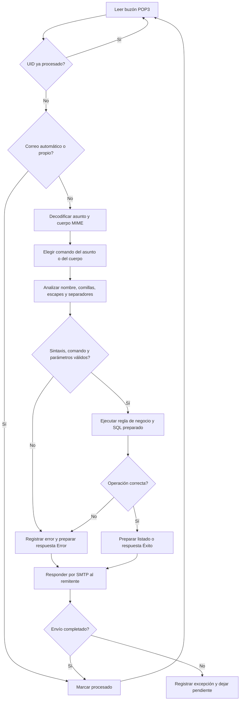

# Tecnoweb Email

Sistema de selección de personal operado íntegramente mediante **correo electrónico (POP3 / SMTP)** y conectado a **PostgreSQL**. Permite gestionar usuarios, candidatos, consentimientos, empresas, cargos, pruebas de evaluación, ranking, informes en PDF y reportes estadísticos en CSV enviando comandos en el asunto del correo.

> Para consultar la lista completa de comandos disponibles por caso de uso, revisa [COMANDOS.md](COMANDOS.md).

El modelo vigente tiene **26 tablas**. Un **reclutado** es un candidato con una
postulación aprobada; el ayudante es quien evalúa.

**Instalación:** ejecuta `sql/talento_schema.sql` en una base vacía para crear
las 26 tablas del sistema.

---

## Requisitos

- **Java 21** (JDK 21)
- **Maven**
- **PostgreSQL 14 o superior**

---

## Cómo ejecutar el proyecto

### 1. Crear la base de datos

Crea la base de datos `talento` en PostgreSQL y carga el esquema inicial incluido en el proyecto:

```powershell
createdb -U postgres talento
psql -U postgres -d talento -v ON_ERROR_STOP=1 -f sql/talento_schema.sql
```

*(También puedes crear la base de datos `talento` desde **pgAdmin 4** y ejecutar el archivo `sql/talento_schema.sql`).*

### 2. Configurar credenciales

Copia el archivo de ejemplo y completa tus datos de correo (POP3/SMTP) y de PostgreSQL:

```powershell
Copy-Item correo.properties.example correo.properties
```

Edita `correo.properties`:
- `pop3.*` y `smtp.*`: servidor, puerto, usuario, contraseña y correo emisor.
- `db.url`, `db.usuario` y `db.password`: conexión a tu base de datos `talento`.

### 3. Compilar y ejecutar

Iniciar el servicio de escucha continua (revisa el buzón cada 10 segundos):

```powershell
mvn compile exec:java
```

*(Presiona `Ctrl + C` para detenerlo).*

#### Opciones adicionales

- **Revisar el buzón una sola vez y salir:**

  ```powershell
  mvn compile exec:java "-Dexec.args=--una-vez"
  ```

- **Probar un comando directamente en consola sin enviar correo:**

  ```powershell
  mvn compile exec:java "-Dexec.args=--probar AYUDA[*]"
  ```

---

## Uso rápido por correo

Envía un correo a la cuenta configurada colocando el comando en el **Asunto** con el formato `COMANDO["param1","param2",...]`. Por ejemplo:

- `AYUDA["*"]` — Devuelve la lista de todos los comandos.
- `LISPER["*"]` — Lista las personas registradas.
- `INSPER["4715292","","SC","Juan Carlos","Perez Seras","2000-05-12","71055123"]` — Registra una persona.

También se admite el formato de siete parámetros indicado por el laboratorio:

```text
INSPER["4715292","Juan Carlos","Perez Seras","Estudiante","33554433","71055123","juanperez@uagrm.edu.bo"]
```

Sus campos son CI, nombres, apellidos, ocupación, teléfono fijo, celular y correo.
En este formato no se inventa fecha de nacimiento ni departamento de expedición.
El esquema `sql/talento_schema.sql` incluye esos campos.

## Arquitectura y estructura

```text
PuntoDeEntrada.java              Recepción POP3, respuesta SMTP y control de duplicados
Presentacion/                   Parser, formato de respuestas, adjuntos y auditoría
Negocio/                        Validación de parámetros y reglas de cada CU
Dato/                           Consultas e inserciones con PreparedStatement
Conexion/ConexionDB.java        Conexión a PostgreSQL, esquema talento
sql/talento_schema.sql          Modelo vigente: 26 tablas
src/test/java/                  Pruebas locales e integración contra base de prueba
scripts/                        Ejecución reproducible de pruebas
```

Las tablas se agrupan en usuarios (`rol`, `usuario`, `persona`), privacidad y
documentos, empresas y cargos, instrumentos y preguntas, planes y postulaciones,
intentos y resultados, ranking e informes. Las relaciones y las 26 tablas por
caso de uso se detallan en [COMANDOS.md](COMANDOS.md).

## Flujo del analizador de correos



## Parsing, UTF-8 y errores

- Acepta espacios, tabulaciones y espacios Unicode alrededor del comando y sus
  separadores. Conserva los espacios dentro de los valores entre comillas.
- El nombre del comando no distingue mayúsculas y minúsculas. Reconoce los
  prefijos de respuesta `Re:`, `Fw:`, `Fwd:` y `Rv:`.
- Los parámetros van entre comillas dobles y separados por comas. Una coma o
  un corchete dentro del texto entre comillas forma parte del valor.
- Para incluir comillas dobles, usa `\"`; para una barra invertida, `\\`.
  Las secuencias desconocidas conservan su barra: no se interpreta `\n` como salto.
- JavaMail decodifica los encabezados y cuerpos MIME; las respuestas utilizan UTF-8.
- Comillas sin cerrar, comas finales y parámetros incompletos producen `Error`.
  Un asunto que intenta contener un comando pero es inválido no se sustituye
  silenciosamente por otro comando del cuerpo.
- INSPER valida siete parámetros, CI, longitudes, teléfonos, correo y fecha
  según el formato elegido antes de ejecutar SQL. PostgreSQL verifica la
  unicidad del CI y las demás restricciones.

Ejemplos:

```text
  LISPER  [ "*" ]
ECO["María Muñoz, selección"]
ECO["El candidato dijo \"sí\""]
```

## Auditoría local

`logs/access.log` registra la recepción y finalización de cada correo nuevo,
el comando, el número de parámetros y el resultado. `logs/error.log` registra
los fallos de parsing, validación, consulta y transporte con su traza.
Ambos archivos se escriben en UTF-8 y están excluidos de Git. No se registra
el cuerpo completo ni la lista de valores del comando. Las excepciones SQL
pueden incluir detalles del registro rechazado; los logs deben permanecer locales.

## Pruebas del parser

```powershell
mvn dependency:copy-dependencies
./scripts/probar-parser.ps1
```

Estas pruebas verifican espacios Unicode, tildes, comillas escapadas, rutas,
errores de sintaxis, mensajes MIME y creación de logs. No acceden al servidor
de correo ni a una base de datos. Las pruebas de integración y sus requisitos
se encuentran en `src/test/java` y se ejecutan con `scripts/probar-modelo.ps1`.

## Infraestructura de laboratorio

Para desplegar en la infraestructura indicada por la cátedra, sustituye los
valores locales de `correo.properties` por los asignados a tu grupo:

```properties
db.url=jdbc:postgresql://db.tecnoweb.org.bo:5432/db_grupoXXsa?currentSchema=talento,public
db.usuario=grupoXXsa
db.password=CONTRASENA_ASIGNADA_POR_LA_CATEDRA
smtp.emisor=grupoXXsa@tecnoweb.org.bo
```

Configura los hosts, puertos y seguridad POP3/SMTP con los valores de la cátedra.
El archivo `correo.properties` está excluido de Git; publica solamente el ejemplo
sin contraseñas reales. Conserva el proyecto en el repositorio personal requerido
`inf513-proyecto1`. Estas pruebas locales no verifican acceso a la infraestructura
externa ni publican el repositorio.
